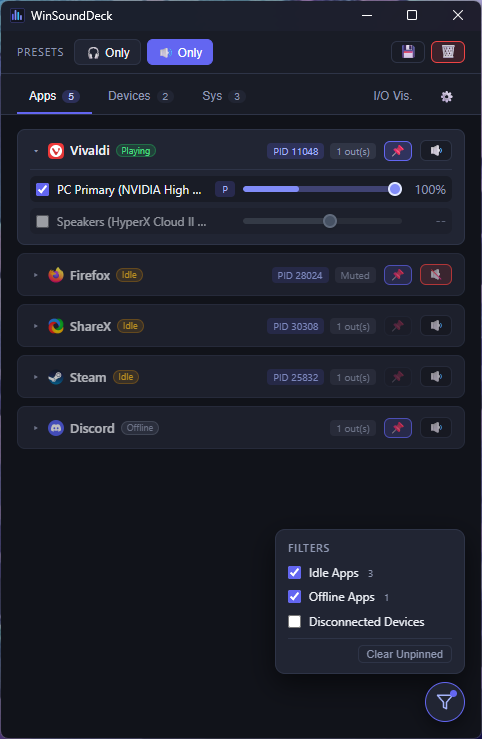
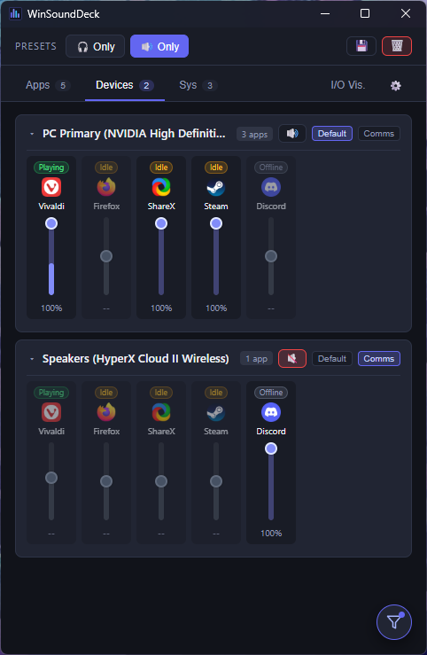

# WinSoundDeck

**Lightweight, driver-free audio routing, per-app multi-output mixing, and one-click hardware presets for Windows 10 & 11.**

WinSoundDeck gives you full control over where every application plays, how loud it is on each output device, and how your Windows audio defaults behave—without installing virtual audio cables, kernel drivers, or bloated peripheral suites.

<table>
  <tr>
    <td align="center"> <b>Apps View</b> — Per-app routing, pinning &amp; filters</td>
    <td align="center"> <b>Devices View</b> — Vertical fader deck per output</td>
  </tr>
</table>

---

## Why WinSoundDeck?

- **Zero Virtual Drivers:** Works directly with Windows Core Audio in user mode. No virtual sound cards cluttering your Windows Sound settings, no forced surround downmixing, and no audio drop-outs from driver crashes.
- **Two Views for Any Workflow:** Manage routing **per-application** in the **Apps** tab, or switch to the **Devices** tab for a compact vertical-fader sound deck organized by output device.
- **Play to Multiple Devices at Once:** Send an app to your headphones *and* mirror it to desktop speakers or a TV simultaneously—each with its own independent volume slider.
- **Dock & Headset Resilient:** Automatically recovers your routes and active preset when you plug or unplug a USB-C dock, monitor, or Bluetooth headset.
- **Tiny Footprint:** Built in native Rust + Tauri with zero telemetry, no account required, and an optional system-tray **Launch at Windows login** toggle.

---

## Key Features

### 🎛️ Apps & Devices Mixer Views
- **Apps Tab:** View **Playing**, **Idle**, and **Offline** apps with native Windows app icons, live in-track peak meters, multi-PID grouping, and one-click **Pin (`📌`)** to keep an app's routes and volumes saved across restarts.
- **Devices Tab:** High-density vertical fader strips with app icons on top, click-to-toggle routing, quick **Default** / **Comms** / **Mute** controls per device, and a right-click menu to **Pin** or **Set as Primary Output**.
- **Contextual Filters:** A compact bottom-right filter menu lets you toggle **Idle Apps**, **Offline Apps**, **Disconnected Devices**, or **Clear Unpinned** without cluttering the main window.

### ⚡ One-Click Global Presets
- Save your entire audio setup—hardware volumes, mute states, Windows **Default** and **Communications** roles, and per-app routes/mirrors—as named presets.
- Switch presets from the main window or directly from the **System Tray** icon.
- Clearing an active preset cleanly restores your pre-preset hardware volumes and Windows defaults.

### 🔌 Clean Device Management (`Sys` & `I/O Vis.`)
- **System (`Sys`) Tab:** Adjust master volume/mute, live peak meters, and Windows **Default** / **Comms** roles for outputs and microphones. Right-click any device to **Hide** it.
- **I/O Visibility (`I/O Vis.`):** Hide unused HDMI monitors or virtual outputs from your mixer, view offline device history, jump to Windows Bluetooth settings, or clean up stale offline entries.

---

## Getting Started

### Download & Run (Windows 10 / 11, x64)
Grab the latest build from **GitHub Releases**:

- **Portable (`WinSoundDeck-portable.exe`):** Single self-contained executable—run it from anywhere with no installation required.
- **Installer (`WinSoundDeck_*_x64-setup.exe`):** Standard Windows installer with Start Menu shortcut and clean upgrade/uninstall hooks.

Once running, WinSoundDeck lives in your **System Tray** and remembers its window position across multi-monitor setups.

---

## How It Compares

Looking at how WinSoundDeck stacks up against **SteelSeries GG Sonar** or **Logitech MIXLINE**? See [doc/01_available_alternatives.md](doc/01_available_alternatives.md).

---

## Documentation & Contributing

- [User Manual](doc/99_User_Manual.md)
- [Development Guidelines & Building from Source](doc/02_development_guidelines.md)
- [High-Level Architecture & Spec](doc/00_high_level_spec.md)
- [Design Decisions](doc/04_design_decisions.md)
- [Creating a Release](doc/05_create_release.md)

---

## License

Dual-licensed under either of:

- **MIT License** ([LICENSE](LICENSE))
- **Apache License, Version 2.0** ([LICENSE-APACHE](LICENSE-APACHE))

at your option.
