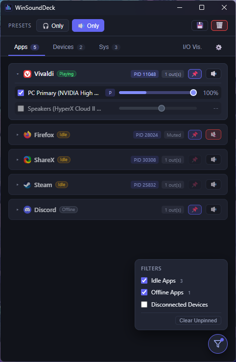
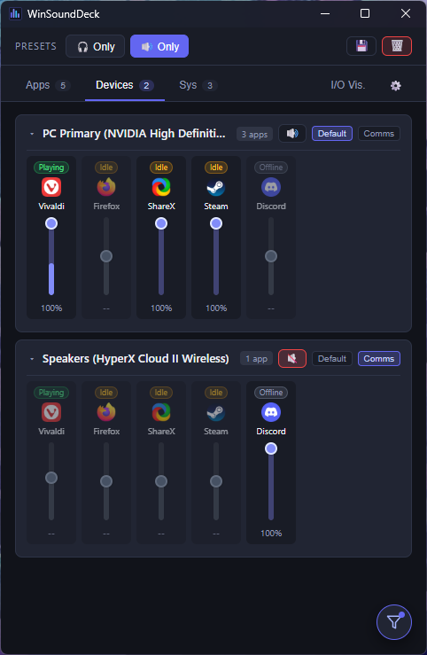
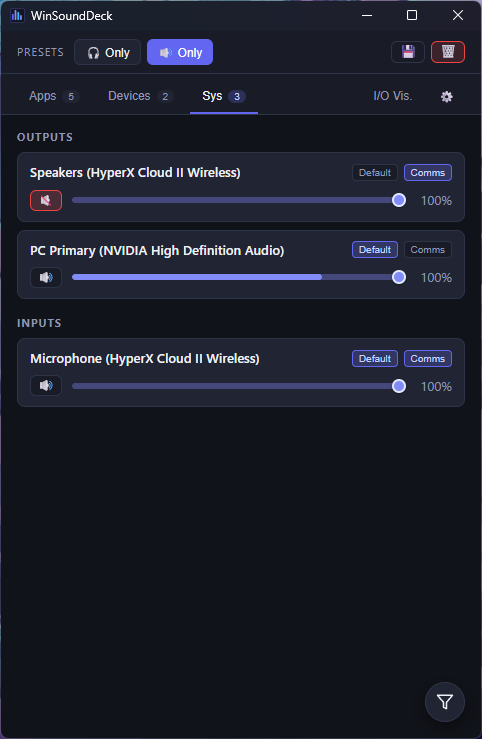
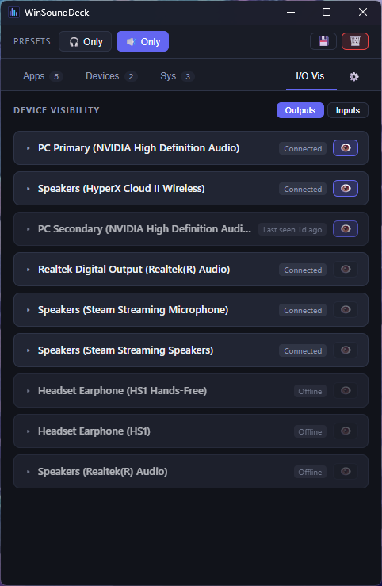
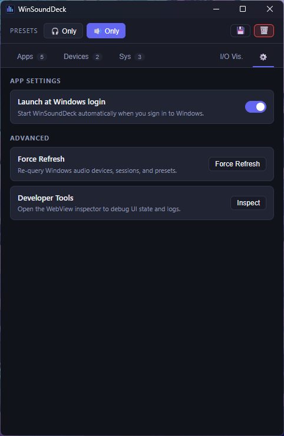

# WinSoundDeck — User Manual

Welcome to **WinSoundDeck**, a lightweight Windows 10 & 11 audio router, per-application multi-output mixer, and preset manager.

---

## 1. Getting Started & System Tray

WinSoundDeck is available in two formats from **GitHub Releases**:

- **Portable (`WinSoundDeck-portable.exe`):** A single self-contained executable you can run from any folder without installing.
- **Windows Installer (`WinSoundDeck_*_x64-setup.exe`):** Standard installer with Start Menu integration and clean upgrade/uninstall support.

### System Tray Behavior
- Closing the window (`✕`) minimizes WinSoundDeck to the **System Tray** so your audio routing and hot-plug presets keep running in the background.
- **Left-click** the tray icon to reopen the window.
- **Right-click** the tray icon to **Open WinSoundDeck**, switch **Presets** directly, or **Quit** (which cleanly shuts down the background audio service).

---

## 2. Presets Bar

The **Presets** bar sits at the top of the window and lets you switch entire audio setups in one click:

- **Apply a Preset:** Click any preset pill to apply its saved hardware volumes, mute states, Windows **Default** / **Communications** roles, and per-app routes/mirrors.
- **Clear Active Preset:** Click the highlighted (active) preset pill again to deactivate it and restore your previous hardware volumes and OS defaults.
- **Save Current Setup (`💾`):** Click `💾`, enter a name (e.g., `Headset`, `Desk`, `Living Room TV`), and confirm (`✅`) to snapshot your current device states, OS roles, and pinned app routes.
- **Delete a Preset (`🗑️`):** Select a preset and click `🗑️` (then `✅` to confirm) to remove it.

---

## 3. Apps Tab

The **Apps** tab organizes audio by application, giving you fine-grained routing and volume control for every program.

  

### App Card Controls
- **State Badge:** Shows whether the app is **Playing** (green), **Idle** (amber — running, not currently playing audio), or **Offline** (slate — not running).
- **PID / Multi-PID Badge:** Shows the active process ID, or `N PIDs ▸` for multi-process apps (click `N PIDs ▸` to expand and control individual processes).
- **Output Count (`1 out(s)` / `Muted`):** Shows how many output devices the app is currently routed to.
- **Pin (`📌`):** Pinned apps remember their primary output, mirrored outputs, volumes, and mute state across restarts and appear in **Offline** when closed. Unpinned apps stay in memory only until cleared or exited.
- **Mute (`🔉` / `🔇`):** Mutes or unmutes the application across Windows (and automatically deselects it in the **Devices** tab).

### Routing & Multi-Output Mirroring
Expand an app card to view available output devices (ordered **Default → Comms → Alphabetical**):
- **Primary Output (`P`):** Check a device to route the app's primary Windows audio stream to it.
- **Mirror to Additional Devices:** Check a *second* (or third) device to mirror the app's audio simultaneously with its own independent volume slider.
- **Change Primary Output:** **Right-click** any output row inside an app card and select **⭐ Set as Primary Output** (already-primary rows display `✓ Primary Output`).

---

## 4. Devices Tab

The **Devices** tab flips the view—organizing your mixer by **output device** with compact vertical faders for fast, high-density control.

  

### Device Card Header
- Devices are ordered **Default → Comms → Alphabetical**.
- **`N apps` Badge:** Shows how many unmuted apps are currently playing to that device.
- **Mute (`🔊` / `🔇`):** Mutes or unmutes the hardware device.
- **Default / Comms:** One-click buttons to set the device as Windows **Default** (`Multimedia` & `Console`) or **Communications** default.

### Vertical Fader Strips
- **Left-to-right order:** **Playing** → **Idle** → **Offline** (controlled via the floating **Filters** button).
- **Click Icon or App Name:** Toggles whether that app is routed/mirrored (or muted/unmuted) on that device. Dimmed strips are inactive/deselected.
- **Drag Fader:** Adjusts that app's volume on that specific device, with a live bottom-to-top peak meter inside the track.
- **Right-Click Menu:** Right-click any strip to **📌 Pin App** / **Unpin App** or **⭐ Set as Primary Output**.

---

## 5. Sys (System) Tab

The **Sys** tab gives you direct hardware control over all enabled **Outputs** and **Inputs (Microphones)**.

  

- **Mute (`🔊` / `🔇`) & Volume Slider:** Controls hardware endpoint volume and mute state with live in-track peak meters.
- **Default / Comms:** Assigns Windows Default and Communications Default for both playback devices and microphones.
- **Right-Click `👁️ Hide`:** Right-click any device card in **Sys** and choose **👁️ Hide** to remove it from **Apps**, **Devices**, and **Sys** (you can re-enable it anytime in **I/O Vis.**).

---

## 6. I/O Vis. (Device Visibility) Tab

Windows PCs often accumulate unused audio endpoints (HDMI monitor speakers, VR headsets, old Bluetooth profiles). **I/O Vis.** keeps your mixer clutter-free.

  

- **Outputs / Inputs Subtabs:** Switch between playback and capture devices.
- **Sort Order:** Devices are sorted **Visible (enabled) → Connected → Alphabetical**.
- **Visibility Toggle (`👁️`):** Click the eye icon to show or hide a device in **Apps**, **Devices**, and **Sys**.
- **Offline Device History & Cleanup:** Expand any offline device (`▸`) to inspect its endpoint ID and choose:
  - **Open Bluetooth Settings:** Jumps straight to Windows Bluetooth settings for paired Bluetooth devices.
  - **Forget:** Removes the remembered offline entry from WinSoundDeck's history.
  - **Uninstall from Windows:** Removes orphaned PnP audio devices from Windows Device Manager (prompts for UAC administrator approval).

---

## 7. Floating Filters Menu

Click the **filter button** in the bottom-right corner to open contextual filters for the tab you're currently viewing (a dot on the icon indicates active filters):

- **Idle Apps:** Include running apps that aren't currently playing audio (remembered across restarts).
- **Offline Apps:** Include closed apps that are pinned or still in session memory (remembered across restarts).
- **Disconnected Devices:** Temporarily show allowed offline devices in **Apps**, **Devices**, and **Sys** for pre-configuring routes or presets.
- **Clear Unpinned:** Removes non-pinned offline apps from the list immediately.

---

## 8. App Settings (`⚙️`) Tab

  

- **Launch at Windows login:** Automatically starts WinSoundDeck when you sign in to Windows (`HKCU\...\Run`).
- **Advanced → Force Refresh:** Manually re-queries all Windows audio devices, sessions, and presets.
- **Advanced → Developer Tools (`Inspect`):** Opens the WebView inspector to view console logs or debug UI state (standard browser right-click menus are disabled elsewhere in the app).

---

## 9. Configuration Files & Troubleshooting

WinSoundDeck stores your configuration locally in `%APPDATA%\audio-mixer\`:
- `presets.json` — Saved global presets.
- `app_settings.json` — Pinned apps, device visibility allowlist, and known endpoint history.
- `window_state.json` — Last window size and multi-monitor position.

If you encounter a Windows audio or device-routing issue, you can run `troubleshoot.ps1` from the repository root to capture a diagnostic snapshot of your Windows WASAPI endpoints and PnP audio devices.
